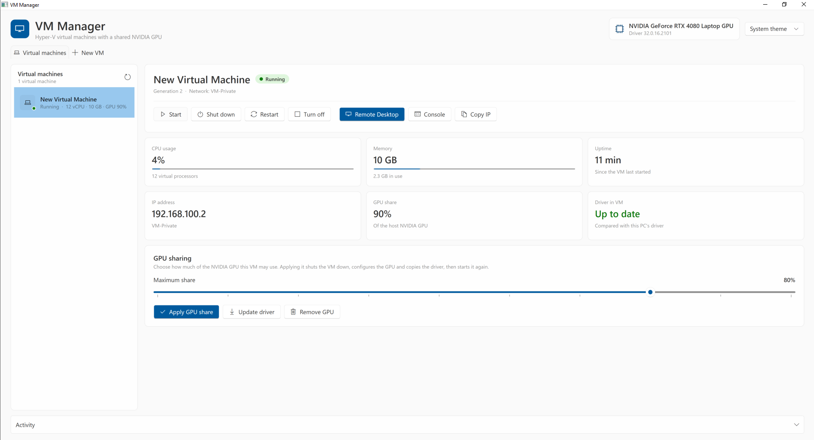
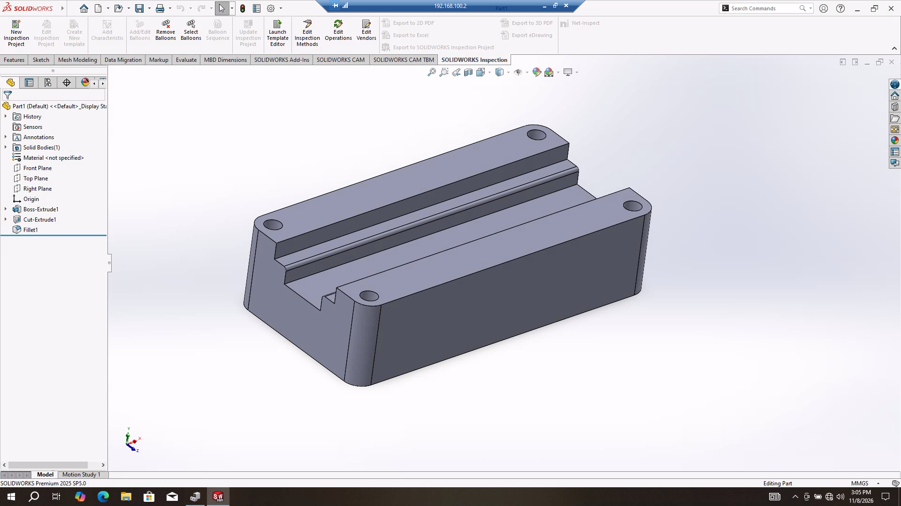
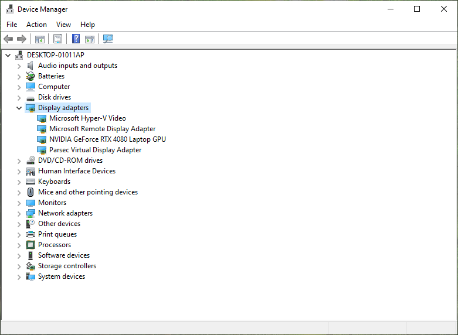

# VM GPU Share

**Share your NVIDIA GPU with Hyper-V virtual machines.** A Windows desktop app that sets up GPU partitioning (GPU-P) for your VMs, copies the NVIDIA driver into them and keeps it up to date. Formerly named *VM Manager*.
Built with WPF on .NET 10 and its Fluent 2 theme: light and dark mode follow Windows.



## Features

- **Virtual machines:** every Hyper-V VM in one list, with a status dot and summary. The page for the selected VM shows:
  - **Live stats:** CPU usage, memory in use, uptime, IP address, network, GPU share. They refresh every 3 seconds.
  - **Power:** Start, Shut down, Restart, Turn off.
  - **Connect:** Stream, the Hyper-V console, Copy IP.
- **GPU sharing:** give a VM 10–100% of the host NVIDIA GPU. The app:
  - adds the GPU partition with the needed VM settings (fixed memory, no checkpoints, MMIO space)
  - copies the host's NVIDIA driver into the VM by mounting its virtual disk, with no files to move by hand
  - warns when the VM's driver is older than the host's, with an **Update now** button
- **New VM tab:** create a Generation 2 VM that's ready for GPU sharing in one step:
  - name, Windows ISO, processors, memory, disk size, network
  - optional TPM for Windows 11
  - optional "only allow this PC" network filter (Hyper-V port ACLs)
- **Fluent design:**
  - in-window confirmation dialogs and InfoBars for task progress and results
  - theme picker (System / Light / Dark)
  - remembers window size, theme, GPU % and the last selected VM

## In use

SolidWorks 2025 running inside a VM that shares the host's RTX 4080, opened with Remote Desktop:



Inside the VM, Device Manager lists the shared GPU next to Hyper-V's own display adapters:



## Requirements

- Windows 10 (21H2 or later) or Windows 11, **Pro / Enterprise / Education**, with **Hyper-V** turned on
- An **NVIDIA GPU** that Hyper-V can partition (`Get-VMHostPartitionableGpu`, or `Get-VMPartitionableGpu` on Windows 10)
- **Administrator rights.** The app asks for them when it starts.
- To build: the [.NET 10 SDK](https://dotnet.microsoft.com/download), or Visual Studio with the ".NET desktop development" workload
- **The VM must run the same Windows version as the host PC:**

  | Host PC | Virtual machine |
  |---|---|
  | Windows 10 | Windows 10 |
  | Windows 11 | Windows 11 |

> [!IMPORTANT]
> **Use the same Windows version on the host and in the VM.** The VM runs the host's NVIDIA driver files, which the app copies in. If the host and VM run different Windows versions, the GPU may not work in the VM: it can show an error in Device Manager (often Code 43), or no GPU acceleration at all. A Windows 10 host needs Windows 10 VMs, and a Windows 11 host needs Windows 11 VMs.

## Getting started

**In short:** install Windows in a Hyper-V VM first, then run VM GPU Share to set up GPU sharing.
The app copies the NVIDIA driver into the VM's Windows, so Windows has to be installed there before you share the GPU.

### 1. Turn on Hyper-V (once)

Open **Turn Windows features on or off**, tick **Hyper-V**, and restart. Or run this in PowerShell **as administrator** and restart:

```powershell
Enable-WindowsOptionalFeature -Online -FeatureName Microsoft-Hyper-V -All
```

### 2. Create a VM and install Windows

Use the **same Windows version as this PC** (Windows 10 → Windows 10, Windows 11 → Windows 11). Pick one way:

- **With VM GPU Share:**
  1. Download the latest `.exe` from **[Releases](../../releases/latest)** and run it.
  2. Open the **New VM** tab, choose a name, the Windows ISO, processors, memory and disk, then click **Create VM**.
  3. The VM starts and its console opens.
- **With Hyper-V Manager:** go to **Action → New → Virtual Machine** and choose:
  - **Generation 2**
  - **untick "Use Dynamic Memory"**
  - your Windows ISO

Then install Windows in the VM:
1. In the console, press a key when it says *"Press any key to boot from CD or DVD"*.
2. Install Windows, finish the setup, and sign in.
3. **Give your Windows account a password.** Remote Desktop needs one.
4. Shut the VM down, or leave it running: VM GPU Share handles both.

### 3. Share the GPU

1. Run VM GPU Share and accept the administrator prompt.
2. Select your VM in the list.
3. Under **GPU sharing**, set the **Maximum share** slider, e.g. 80%.
4. Click **Apply GPU share** and confirm.

The app then:
- shuts the VM down
- adds the GPU and the settings it needs (fixed memory, checkpoints off)
- copies this PC's NVIDIA driver into the VM
- starts the VM again

When it's done, **Driver in VM** shows **Up to date**.

### 4. Check the GPU in the VM

Inside the VM, open **Device Manager → Display adapters**. Your NVIDIA GPU should be listed **without a warning sign** (see the screenshot above).

### 5. Use the VM

- **Remote Desktop** (the Stream button, or `mstsc /v:<VM IP>`) gives you GPU-accelerated apps, such as SolidWorks or other 3D software.
- **Console** opens the basic Hyper-V window. It's fine for setup, but it doesn't show GPU acceleration.

### After you update the NVIDIA driver on this PC

The VM list marks the VM's driver as **Needs update**. Select the VM and click **Update now** (or **Update driver**) to copy the new driver in.

## Build and run

```bash
dotnet build "VM Manager.csproj" -c Release
```

Then run `bin\Release\net10.0-windows\VM GPU Share.exe` and accept the administrator prompt.
To debug in Visual Studio, start Visual Studio **as administrator**.

**Streaming:** the Stream button opens `VMStreamViewer.exe` if it sits next to the app. Otherwise it uses Moonlight if it's installed, and Remote Desktop to the VM's IP if not.

## How it works

The Hyper-V PowerShell module only runs in **Windows PowerShell 5.1**, which .NET 10 can't host inside the app. So the app:

- starts two hidden `powershell.exe` workers (`HyperV/PowerShellWorker.cs`): one refreshes the list, one runs longer jobs, so the window never freezes
- sends each worker the embedded scripts `HyperV/GpuLib.ps1` (the Hyper-V and GPU commands) and `HyperV/Worker.ps1` (a request loop)
- talks to them over stdin/stdout, one JSON request at a time; progress lines come back as `LOG`, results as `RESULT` or `ERROR`

| File | Purpose |
|---|---|
| `MainWindow.xaml` / `.cs` | The window: VM list, details page, New VM tab, dialogs, InfoBars |
| `App.xaml` / `.cs` | Fluent theme, shared styles, theme switching, error logging |
| `VmRow.cs` | One VM as shown in the list and on the details page |
| `AppSettings.cs` | Saved settings (`%APPDATA%\VM GPU Share\settings.json`) |
| `HyperV/GpuLib.ps1` | Hyper-V and GPU commands: list VMs, share or remove the GPU, copy the driver, create VMs |
| `HyperV/PowerShellWorker.cs`, `Worker.ps1` | The background PowerShell worker and its protocol |
| `app.manifest` | Requests administrator rights |

## Good to know

- **The VM is shut down** while the GPU is added or removed or the driver is copied, then started again. The app asks first.
- **After every NVIDIA driver update on the host,** use **Update driver** for each VM. The list marks VMs whose driver is out of date.
- **Each VM's share is a maximum, not a reservation.** The host and running VMs share the GPU.
- **GPU partitioning on client Windows** works with recent NVIDIA drivers, but Microsoft documents it mainly for Windows Server.
- **If something goes wrong at runtime,** the app shows the error and writes it to `error.log` next to the `.exe`.
